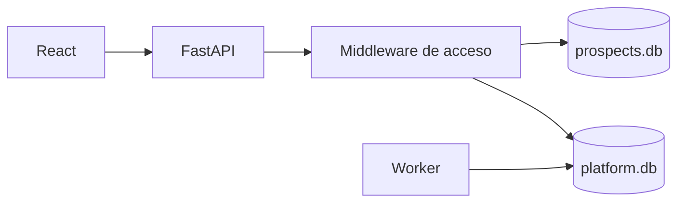

# Arquitectura

AshenCRM sigue siendo un monolito: React/Vite y FastAPI. Hay una sola organización. No se inventó un `organization_id` para simular multi-tenant.

## Acceso

- Público: `GET /api/livez` y `GET /api/auth/config`.
- Cualquier rol: lecturas de `/api`.
- `campaigns:run`: escrituras de operador, incluido crear una ejecución.
- `runs:cancel`: pausa, reanudación, cancelación y reintento.
- `outreach:send`: `send-whatsapp`. Sigue en dry-run fuera de production.
- `role:admin`: todo `/api/admin`, conexiones de Lovable y consola SQL.

El token del navegador vive en `sessionStorage` (`ashencrm.accessToken`). No va en la URL ni en `localStorage`. Sigue expuesto a un XSS de la propia aplicación. Una cookie `httpOnly` exigiría una sesión de servidor que este modo local todavía no tiene. En production `AUTH_MODE=local` no arranca: hace falta OIDC.

## Cola

`platform.db` es independiente de `prospects.db` y está cubierto por `.gitignore`. El worker reclama con una transacción `BEGIN IMMEDIATE` y un `UPDATE` condicionado a `pending`. Postgres tiene otra sentencia, con `FOR UPDATE SKIP LOCKED`, en `POSTGRES_CLAIM_SQL` y el esquema `001_platform.sql`. Esa sentencia no se ejecutó contra un servidor en esta sesión.

Etapas: descubrir, normalizar, deduplicar, enriquecer, puntuar, generar, validar y preparar outreach. Un fallo de generación deja el run en `incomplete` y no marca `demo_created`.

## Lovable

El cliente solo declara el endpoint documentado `https://mcp.lovable.dev` y las herramientas publicadas. No hay API key. Sin token, la comprobación responde `MANUAL_ACTION_REQUIRED`. El cifrado usa Fernet y `PLATFORM_SECRET_KEY`, que no se escribe en la base.

## Outreach

Preparar un mensaje no lo envía. El worker fuerza `live_allowed=False` y guarda `dry_run=1`.
